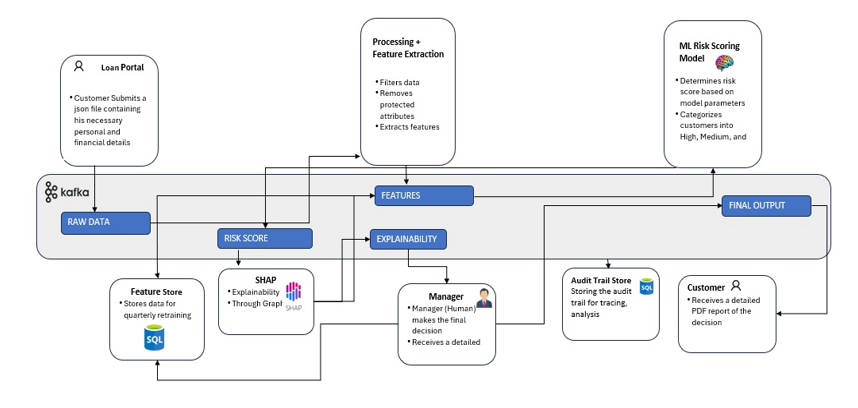
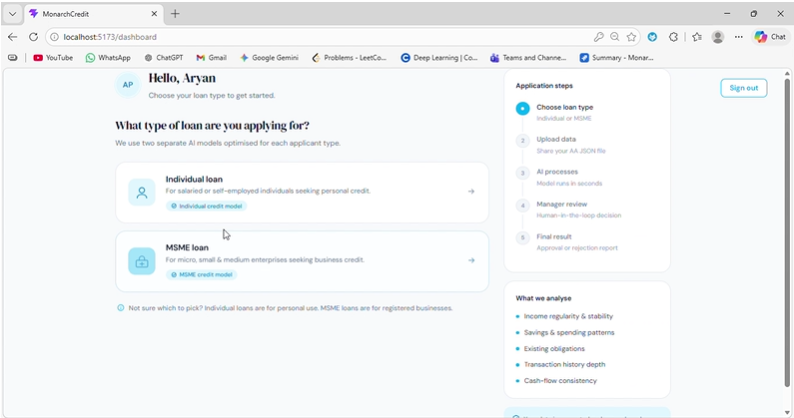
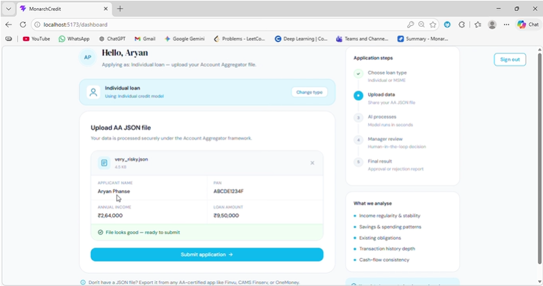
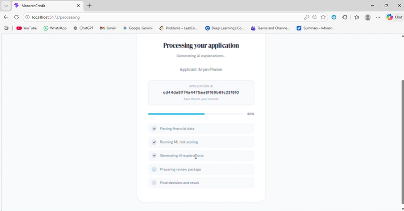
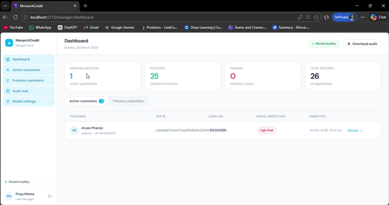
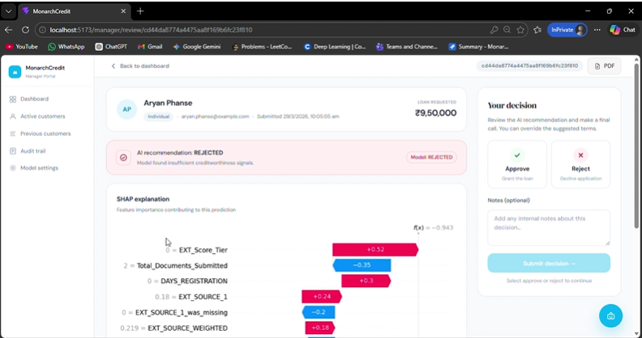
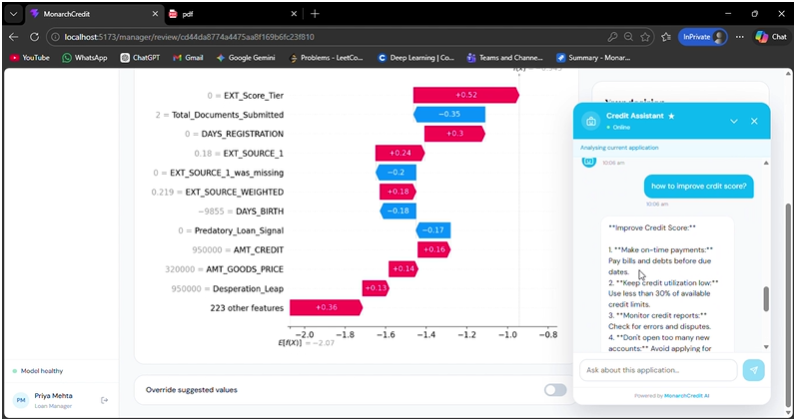

# 🏦 MonarchCredit – AI Powered Alternate Credit Scoring System

🚀 Built for **Barclays Hack-O-Hire 2026**

MonarchCredit is an AI-powered alternate credit scoring platform designed to enable **financial inclusion** by evaluating the creditworthiness of **unbanked and underbanked individuals as well as MSMEs**, beyond traditional CIBIL-based systems.

---

## 📌 Problem Statement

Millions of individuals and MSMEs lack formal credit histories, making them invisible to traditional credit scoring systems. As a result, many creditworthy applicants are denied access to fair lending opportunities. MonarchCredit addresses this gap by using alternative financial signals, machine learning, and explainable AI to assess creditworthiness more inclusively and transparently.

👉 MonarchCredit solves this by:
- Leveraging **behavioral financial data**
- Using **AI-driven risk assessment**
- Providing **transparent and explainable decisions**

---

## 💡 Solution Overview

The system processes structured financial data (simulating Account Aggregator flows) and generates:

- 📊 **Risk Score**
- 💳 **CIBIL-style Credit Score**
- ✅ **Loan Approval / Rejection Decision**
- 💰 **Suggested Loan Terms (Principal & Interest Rate)**

---

## 🧠 Key Features

### 🔹 Dual AI Models
- Separate models for:
  - **Individuals**
  - **MSMEs**
- Tailored features and signals for each segment

---

### 🔹 Responsible Data Processing
- Removes **protected attributes** (gender, religion, etc.)
- Evaluates potential fairness concerns in model decisions

---

### 🔹 Advanced Feature Engineering
- Raw data is transformed into **handcrafted features**
- Captures:
  - Income stability
  - Financial behavior
  - Asset-liability balance
  - Social and behavioral signals

---

### 🔹 Ensemble ML Decision Engine
Built using:
- **XGBoost**
- **Random Forest**
- **LightGBM**

👉 Outputs:
- Risk score
- Loan decision
- Suggested interest rate & principal

---

### 🔹 Explainable AI (SHAP)
- Provides feature-level explanations for model predictions
- Helps reviewers inspect factors contributing to an applicant's score

---

### 🔹 Human-in-the-Loop System
- Managers can:
  - Accept model decisions
  - Override decisions when necessary

---

### 🔹 Dual User Interfaces

#### 👤 Customer Interface
- Upload financial JSON (Account Aggregator simulation)
- View:
  - Credit score
  - Decision
  - Personalized report

#### 🧑‍💼 Manager Interface
- Review applications
- View SHAP explanations
- Override decisions
- Generate reports

---

### 🔹 Automated PDF Reports
- Customer report
- Manager report

Includes:
- Decision summary
- Risk insights
- Loan details
- Explanation

---

### 🔹 AI Chatbot 🤖
An assistant designed to:
- Explain why an applicant was rejected
- Compare multiple applicants
- Help customers understand their reports
- Assist managers with decision insights
- Answer finance-related queries

---

### 🔹 Event-Driven Architecture (Kafka)

The project includes an Apache Kafka-based messaging setup intended to support event-driven processing between services.

- Asynchronous message processing
- Loose coupling between services
- Kafka topics for service communication

Actual reliability and data-loss guarantees depend on Kafka configuration, consumer behaviour, and service implementation.

---

### 🔹 Audit Trail & Compliance
The project includes audit-related components for tracking information such as:
- Customer data
- Model outputs
- Manager decisions
- Governance metadata

The presence of these components does not by itself establish regulatory compliance.

---

### 🔹 Feature Store (Future Scope)
Engineered features could be stored for:
- Future model retraining
- Model monitoring and improvement

---

## 🏗️ System Architecture

<p align="center">
  
</p>

The architecture diagram illustrates the project's intended service flow and Kafka-based messaging design.

---

## 📸 Demo & Screenshots

### 👤 Customer Flow

#### 🏠 Customer Dashboard
<p align="center">
  
</p>

#### 📤 Upload Financial Data
<p align="center">
  
</p>

#### ⏳ Processing & Evaluation
<p align="center">
  
</p>

---

### 🧑‍💼 Manager Flow

#### 📊 Manager Dashboard
<p align="center">
  
</p>

#### 🧾 Decision & Underwriting Page
<p align="center">
  
</p>

---

### 🤖 AI Chatbot

<p align="center">
  
</p>

---

## ⚙️ Tech Stack

### 🔹 Backend
- FastAPI
- Kafka
- Python

### 🔹 Machine Learning
- XGBoost
- Random Forest
- LightGBM
- SHAP

### 🔹 Frontend
- React.js

### 🔹 Infrastructure
- Docker
- ChromaDB

---

## 🔐 Environment Configuration

Before starting the backend, copy the environment template and set your own local database credentials:

```powershell
Copy-Item alternate_credit_backend/.env.example alternate_credit_backend/.env
```

Edit `alternate_credit_backend/.env` and replace the placeholder password with your local MySQL password. Never commit a real `.env` file or database credentials.

## 🚀 How to Run

### 1. Clone the repository

```bash
git clone https://github.com/Rishi-1612/AI-credit-scoring-system.git
cd AI-credit-scoring-system
```

### 2. Start the backend services

```bash
cd alternate_credit_backend
docker compose up -d
```

### 3. Install Python dependencies and start the API

Run these commands from the `alternate_credit_backend` directory:

```bash
pip install -r requirements.txt
uvicorn app.main:app --reload
```

### 4. Start the frontend

Open a new terminal from the repository root:

```bash
cd alternate_credit_frontend
npm install
npm run dev
```

Check the backend configuration and environment variables before running the application locally. Some services may require additional setup depending on your environment.

---

## 📄 License

[](https://opensource.org/licenses/MIT)

This project is licensed under the **MIT License** © 2026 Aryan Phanse.

See the full license here: [LICENSE](./LICENSE)

---

## 📌 Project Notes

- Account Aggregator inputs are simulated rather than connected to a live financial-data provider.
- Model outputs depend on the available data, feature processing, and trained model artifacts.
- This repository is a project implementation and should not be treated as a production lending or regulatory-compliance system without further validation.
